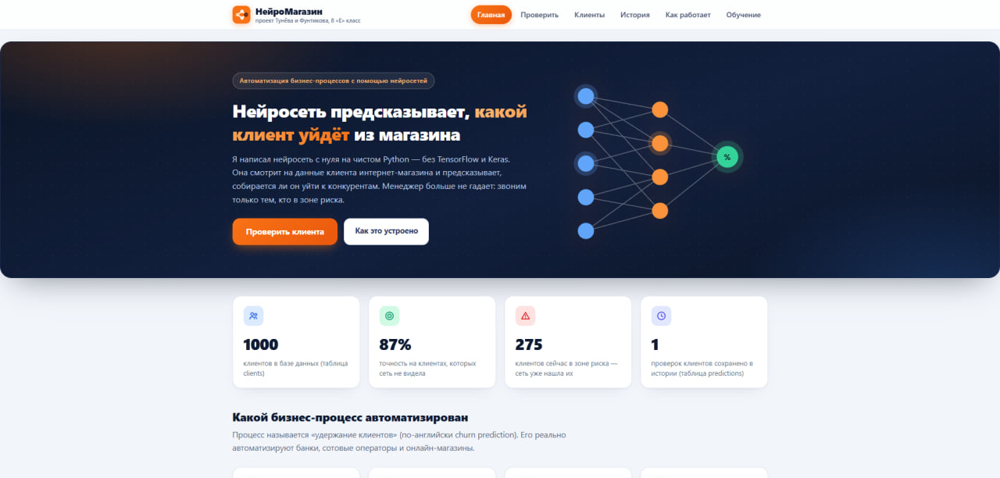
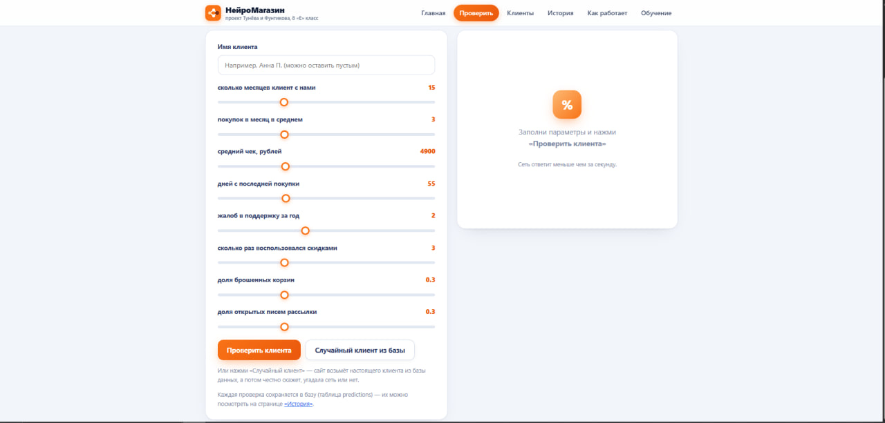
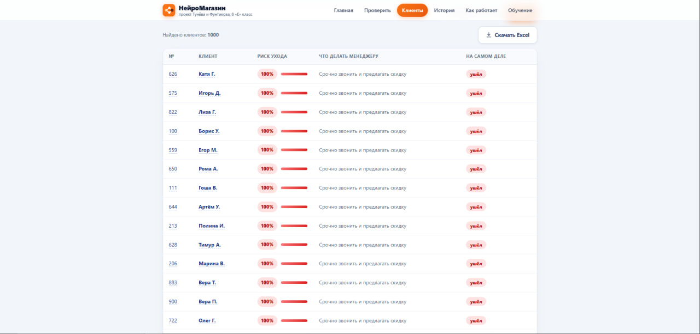
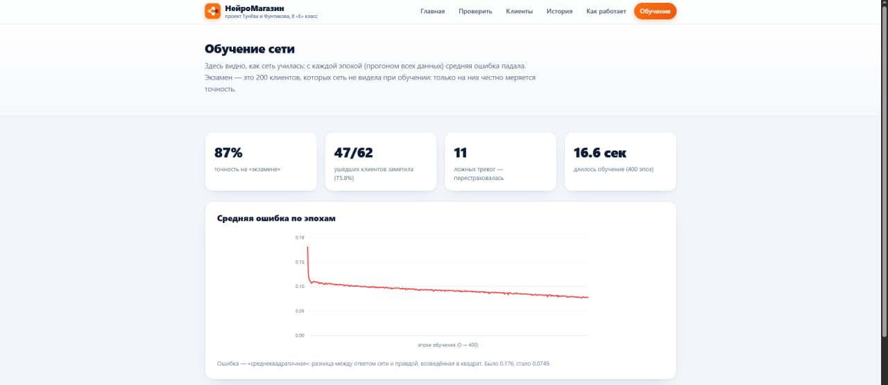

# НейроМагазин - прогноз ухода клиентов (Автоматизация бизнес-процессов)

Школьный проект по теме **"Автоматизация бизнес-процессов с помощью нейросетей"**.

**Авторы:** Тунёв и Фунтиков, ученики 8 "Е" класса МБОУ "СОШ № 34".



## О проекте

Мы сделали сайт для выдуманного интернет-магазина "Всё для дома". Иногда покупатели перестают делать заказы, и магазину важно вовремя это заметить.

Наша программа анализирует данные о покупателе и показывает **риск его ухода в процентах**. Так менеджер может понять, кому стоит предложить помощь или скидку.

Главная особенность проекта - **нейросеть написана на Python с нуля**, без TensorFlow и Keras. Сайт работает на Flask, а данные хранятся в SQLite.

> Важно: все клиенты в проекте выдуманные. Результаты нейросети нужны для демонстрации её работы, а не для настоящих бизнес-решений.

## Что умеет сайт

- Проверять клиента по 8 показателям и показывать риск ухода.
- Выбирать случайного клиента из базы и сравнивать прогноз с его результатом.
- Показывать список клиентов с поиском и фильтрацией.
- Выгружать список клиентов в Excel и загружать данные из CSV.
- Сохранять историю проверок.
- Объяснять устройство нейросети с помощью схем и графиков.
- Показывать результаты обучения и запускать переобучение сети.
- Предлагать мини-игру "Ты против нейросети".
- Переключаться между светлой и тёмной темой.

### Примеры страниц

**Проверка клиента**



**Список клиентов**



**Обучение нейросети**



## Как работает нейросеть

1. В базе хранятся данные о 1000 выдуманных клиентах.
2. Для каждого клиента есть 8 показателей: срок покупок в магазине, частота покупок, средний чек, дни с последней покупки, жалобы, скидки, брошенные корзины и открытые письма.
3. Перед обучением значения приводятся к удобному диапазону.
4. Нейросеть учится на примерах клиентов, которые ушли или остались.
5. После обучения она выдаёт число от 0 до 1, которое на сайте показывается в процентах.

**Схема сети:** `8 -> 16 -> 1`

Это 8 входных показателей, 16 нейронов скрытого слоя и 1 нейрон на выходе. Всего в сети **161 обучаемый параметр** с учётом весов и смещений.

Во время обучения используется метод обратного распространения ошибки (backpropagation). В обычном запуске сеть обучается 400 эпох.

## Результаты

В одном из наших запусков нейросеть правильно определила **174 из 200** тестовых клиентов - это **87% точности**. Из 62 клиентов, которые действительно ушли, она нашла 47.

Эти результаты получены на **искусственно созданных данных**. При новом обучении числа могут отличаться.

## Использованные технологии

| Технология | Для чего нужна |
|---|---|
| Python 3 | Нейросеть и логика программы |
| Flask | Работа сайта |
| Flask-SQLAlchemy | Работа с базой данных |
| SQLite | Хранение клиентов, прогнозов и результатов обучения |
| HTML, CSS, JavaScript | Страницы сайта и интерактивные элементы |
| Jinja2 | HTML-шаблоны |
| openpyxl | Выгрузка данных в Excel |

## Как запустить проект

Нужен **Python 3.10 или новее**. Скачайте файлы репозитория и откройте папку проекта в PyCharm или терминале.

**На Windows:**

```bash
py -m pip install -r requirements.txt
py app.py
```

**На Linux или macOS:**

```bash
python3 -m pip install -r requirements.txt
python3 app.py
```

После запуска откройте в браузере:

**http://127.0.0.1:5000**

Если команда `py` не работает, попробуйте `python`.

Если база `neuro.db` отсутствует, программа создаст её и обучит нейросеть при первом запуске. Это может занять некоторое время.

## Структура проекта

```text
app.py              - сайт на Flask
neuronet.py         - нейросеть и обучение её нейронов
training.py         - запуск обучения и проверка результатов
dataset.py          - создание учебных клиентов и подготовка данных
models.py           - таблицы базы данных
database.py         - создание или обновление учебной базы
neuro.db            - база данных SQLite (если уже создана)
requirements.txt    - нужные библиотеки
templates/          - HTML-страницы
static/             - стили и JavaScript
screenshots/        - фотографии сайта для README
README.md           - описание проекта
```

Для создания базы вручную можно выполнить:

```bash
py database.py
```

Команда `py database.py --fresh` удаляет старые таблицы вместе с данными и создаёт их заново. Используйте её только если хотите полностью сбросить учебную базу.

## Для чего сделан проект

Мы хотели показать, что даже небольшая нейросеть может помогать решать понятную задачу. Во время работы мы научились писать код на Python, использовать Flask и базу данных, а также проверять работу собственной модели.

**Проект предназначен для учёбы и локального запуска.** В нём нет полноценной системы регистрации и защиты административных действий, поэтому публиковать этот Flask-сервер в открытом интернете без доработки не стоит.
